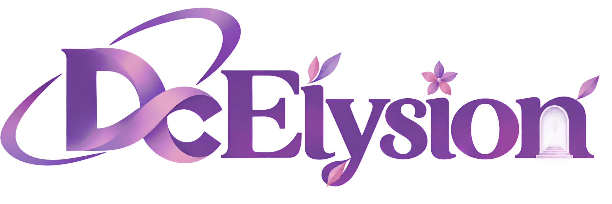
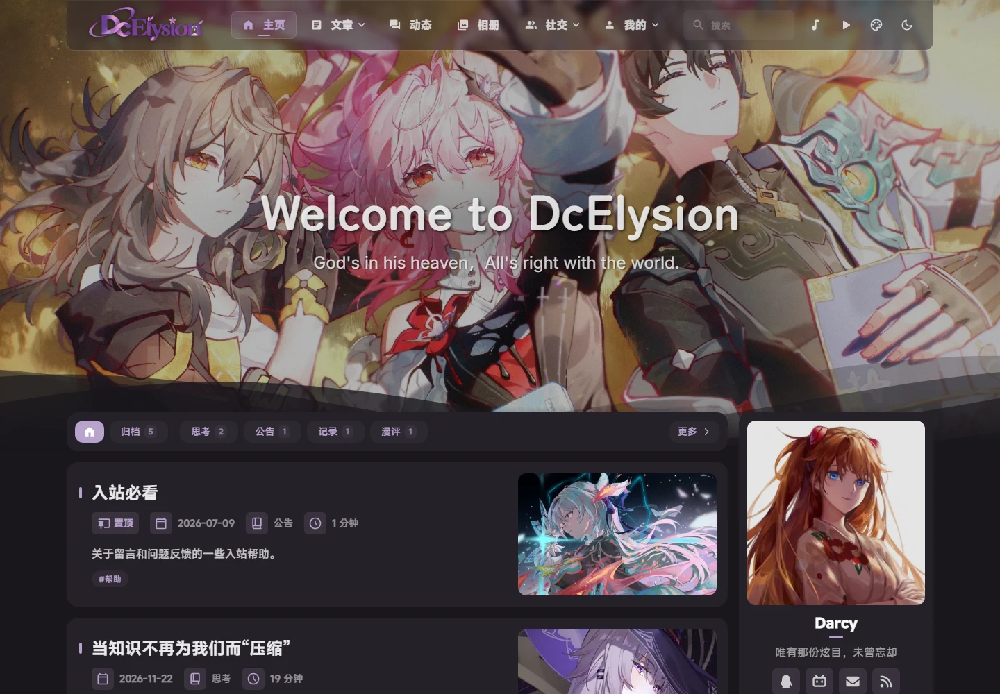
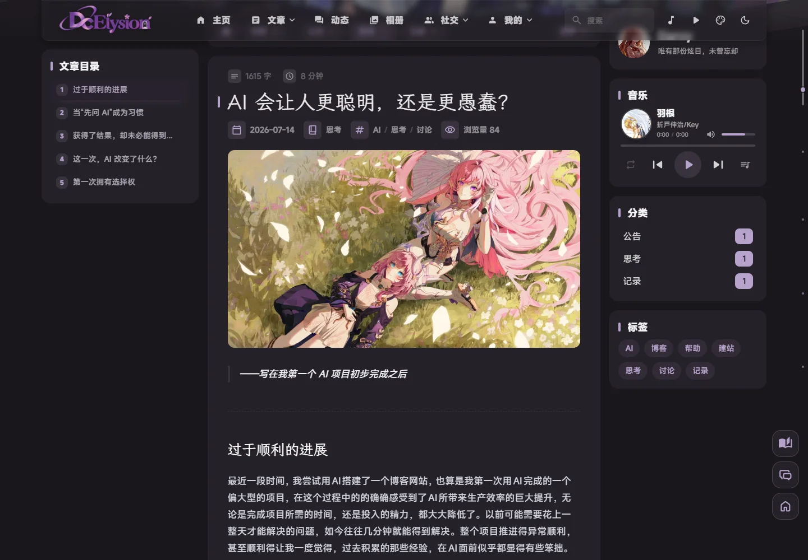
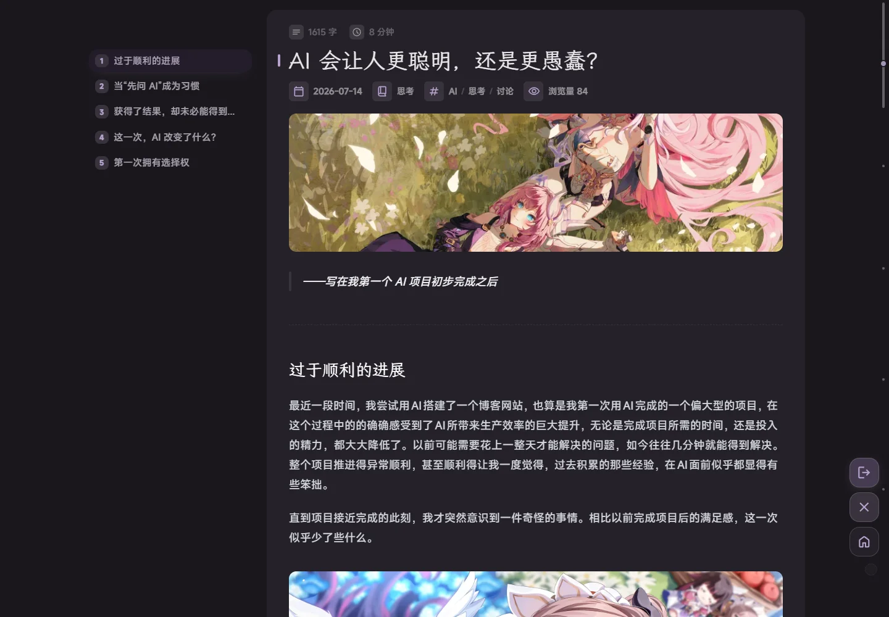
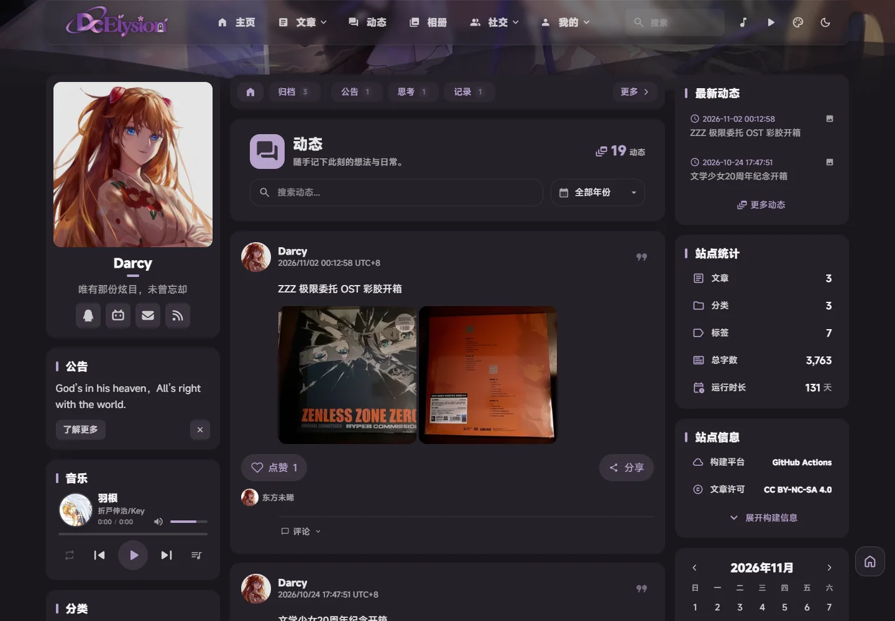
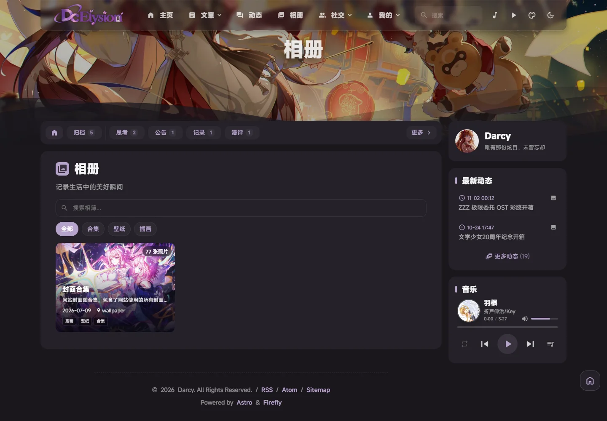
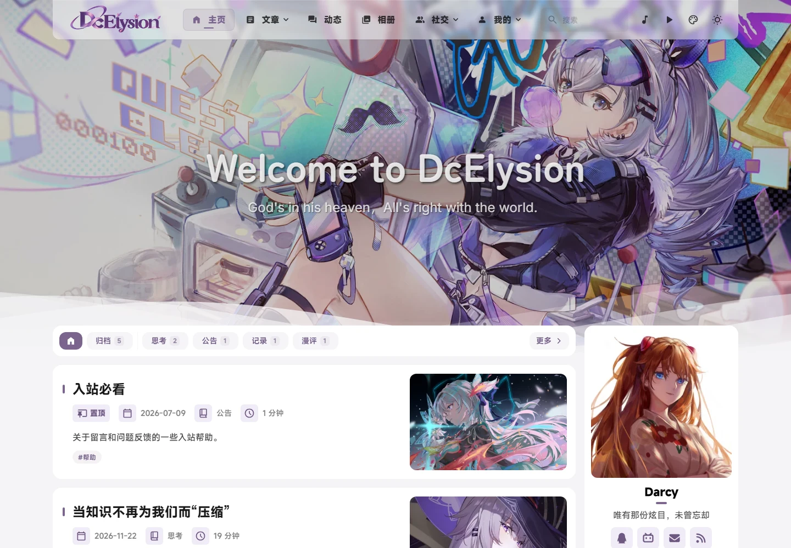
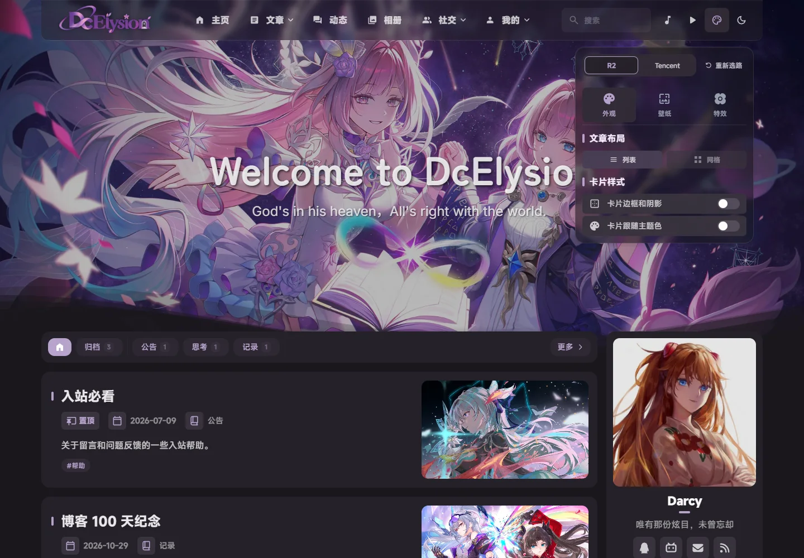

<div align="center">



# DcElysion Blog

**The personal blog of 东方未晞 · Only that dazzling light, never forgotten**

My corner on the internet—where I write long-form essays and anime reviews, share vinyl unboxings, and keep track of the anime, visual novels, and photos I love.

[Visit the blog](https://blog.dcelysion.cn/) · [Homepage](https://dcelysion.cn/) · [Subscribe](https://blog.dcelysion.cn/rss/) · [Run locally](#run-locally) · [Report an issue](https://github.com/Darcy-1024/dcelysion-blog/issues)

[简体中文](README.md) · **English**


</div>



> [!NOTE]
> The blog itself is written in Chinese. This page introduces what lives on the site and how to run or adapt the code for your own blog.

## Site overview

| Section | What's inside |
| --- | --- |
| 📖 [Articles](https://blog.dcelysion.cn/archive/) | Deep-dive anime & VN essays, site-building notes, and personal reflections—browsable by year, category, or tag. |
| 🌸 [Timeline](https://blog.dcelysion.cn/dynamic/) | A cross between a diary and a social feed: everyday moments, unboxings, and quick thoughts. |
| 🖼️ [Gallery](https://blog.dcelysion.cn/gallery/) | Photo albums organized by theme, displayed in their natural aspect ratios. |
| 🎮 [Bangumi](https://blog.dcelysion.cn/bangumi/) · [VNDB](https://blog.dcelysion.cn/vndb/) | My anime and visual novel collections, organized by watch and play status. |
| 💬 [Friends](https://blog.dcelysion.cn/friends/) · [Guestbook](https://blog.dcelysion.cn/guestbook/) | Indie blogs from friends around the web, plus a guestbook to say hello. |

## Start with a few articles

Fleeting ideas, technical write-ups, and long-form reviews after finishing a memorable work all end up here. If you're visiting for the first time, these three posts give a good sense of what the blog is about:

- 🎬 **[Why Has the Silver-Haired Girl Who Never Says "Onii-chan" Remained an Unsurpassed Imouto Classic?](https://blog.dcelysion.cn/posts/yosuga-no-sora-kasugano-sora/)** — Revisiting *Yosuga no Sora* and *Haruka na Sora* to unpack Kasugano Sora's romantic tragedy of codependency, alienation, and rebirth.
- 🤔 **[Does AI Make Us Smarter, or Dumber?](https://blog.dcelysion.cn/posts/ai-smarter-or-dumber/)** — Reflections written right after building the first version of this blog with AI.
- 🎂 **[100 Days of the Blog](https://blog.dcelysion.cn/posts/博客100天纪念/)** — Looking back on how a bare-bones template slowly grew into the site you see today.

For a blog, nothing matters more than the reading experience itself. I spent a lot of time paring away distractions—refining local fonts, spacing, and chapter navigation. Turning on **Immersive Reading** tucks away the top banner, navbar, and sidebars so your eyes can stay on the text, and returns you to your exact scroll position when you exit.

<table><tr>
<td width="50%"></td>
<td width="50%"></td>
</tr></table>

Older posts are organized chronologically in the [Archive](https://blog.dcelysion.cn/archive/) and indexed with full-text [Search](https://blog.dcelysion.cn/search/), which previews matching excerpts right in the results so you can find a post even from half a remembered sentence.

## Timeline, gallery, and collections

Moments that don't need a multi-thousand-word essay live in the **[Timeline](https://blog.dcelysion.cn/dynamic/)** and **[Gallery](https://blog.dcelysion.cn/gallery/)**—whether it's unboxing a *Zenless Zone Zero* vinyl soundtrack, jotting down thoughts on a rainy weekend, or grouping favorite photos into themed albums. Each timeline post has its own permalink, comments, and a one-click shareable poster card.

<table><tr>
<td width="50%"></td>
<td width="50%"></td>
</tr></table>

My anime and visual novel logs live on the **[Bangumi](https://blog.dcelysion.cn/bangumi/)** and **[VNDB](https://blog.dcelysion.cn/vndb/)** pages, complete with cover walls filtered by *Plan to Watch / Watching / Completed* status.

## Music & visual presentation

I have a soft spot for audiovisual presentation. The navbar and sidebar players hold the tracks I usually listen to while writing or daydreaming, balancing high-quality audio and live video wallpapers with fast loading. Thanks to seamless in-site navigation, the music keeps playing uninterrupted as you move from page to page.

In Display Settings, you can switch the homepage between list and grid layouts, toggle light or dark themes, or adjust card transparency to let more of the background wallpaper shine through. On mobile screens, the homepage automatically adapts to a portrait wallpaper and a single-column feed.

<table><tr>
<td width="50%"></td>
<td width="50%"></td>
</tr></table>

## About & community

You can learn more about the person behind the screen on the **[About](https://blog.dcelysion.cn/about/)** page, or visit my standalone **[Homepage](https://dcelysion.cn/)** that shares the same visual identity and playlist. Drop by **[Friends](https://blog.dcelysion.cn/friends/)** to explore other indie blogs, leave a note in the **[Guestbook](https://blog.dcelysion.cn/guestbook/)** (supporting both logged-in accounts and zero-friction anonymous comments), or grab the RSS / Atom feed from the **[Subscribe](https://blog.dcelysion.cn/rss/)** page.

---

## Under the hood

- **Tailored for personal publishing**: Deeply customized from the [Firefly](https://github.com/CuteLeaf/Firefly) theme using Astro, Svelte, TypeScript, and Tailwind CSS, extended with timeline posts, photo albums, Bangumi / VNDB collections, and immersive reading mode.
- **Seamless browsing & search**: Powered by Swup for continuous in-site transitions without interrupting audio playback, paired with Pagefind for static full-text search with excerpt highlighting.
- **Self-hosted interaction & tooling**: Integrates self-hosted Waline comments and user accounts, Memos timeline syncing, a companion visual admin dashboard (`admin/`), and automated scripts for content creation, media processing, and multi-CDN asset delivery.

## Run locally

Requires **Node.js ≥ 22.23.0** and Corepack. The package manager is pinned to **pnpm 11.22.0**; see [package.json](package.json) for exact versions.

```sh
git clone https://github.com/Darcy-1024/dcelysion-blog.git
cd dcelysion-blog
corepack pnpm install --frozen-lockfile
corepack pnpm dev
```

Open the local address printed by the dev server ([localhost:4321](http://localhost:4321/) by default).

| Command | Purpose |
| --- | --- |
| `corepack pnpm dev` | Start the local blog dev server |
| `corepack pnpm check` | Run Astro type and syntax checks |
| `corepack pnpm build` | Build the static site and generate Pagefind search indexes |
| `corepack pnpm preview` | Preview the production build locally |
| `corepack pnpm new-post <name>` | Scaffold a new article from template |
| `corepack pnpm admin:dev` | Start the companion admin dashboard (requires separate setup) |

## Make it your own

Site metadata, navigation, appearance, and feature toggles live in [`src/config/`](src/config/README.md), while Markdown articles and timeline posts live in `src/content/`.

```text
src/
├── components/     Page components, sidebars, and music player
├── config/         Site metadata, navigation, appearance, and feature toggles
├── content/        Articles and timeline posts
└── pages/          Routes and RSS / Atom feeds
admin/              Companion visual content admin dashboard
public/             Fonts, icons, and static assets
scripts/            Content creation, media processing, and build scripts
docs/               Project reference docs and screenshots
```

This repository contains my live personal site configuration. If you adapt it for your own blog, please replace the site info, personal posts, media domains, and third-party service settings, and only publish assets you have the rights to use.

## Deploy

`corepack pnpm build` outputs a purely static site to `dist/`, ready for any static hosting provider. Built-in configurations are included for:

| Platform | Config | Notes |
| --- | --- | --- |
| Vercel | [`vercel.json`](vercel.json) | Builds with `pnpm build`, serves `dist/`, and configures security headers and long-term asset caching. |
| Cloudflare Workers | [`wrangler.jsonc`](wrangler.jsonc) | Serves `dist/` as static assets. |
| GitHub Pages | [`deploy.yml`](.github/workflows/deploy.yml) | Automatically deploys on pushes to `master`. |
| EdgeOne Pages | [`edgeone.json`](edgeone.json) | Serves `dist/` and sets headers for multi-route probe files. |

In production, this site uses a **build-once, deploy-everywhere** pipeline: pushing to `master` triggers [`public-blog.yml`](.github/workflows/public-blog.yml) in GitHub Actions, which builds the site once and publishes the public bundle as a `blog-<commit SHA>` GitHub Release. GitHub Pages, Cloudflare, and EdgeOne then download and verify that exact release package instead of running separate builds. Releases contain only public site files—never the admin app or private data.

<details>
<summary><strong>Fork deployment notes & optional environment variables (click to expand)</strong></summary>

<br />

> [!NOTE]
> If you fork this repository, note that `deploy.yml` and `edgeone.json` download prebuilt releases from this repo by default (defined in [`scripts/download-blog-release.mjs`](scripts/download-blog-release.mjs)). Set your hosting platform's build command to `pnpm build` and output directory to `dist`, or update the download URL so `public-blog.yml` publishes releases in your own repository.

Optional build-time environment variables:

| Variable | Effect |
| --- | --- |
| `PUBLIC_SITE_LANG` | Override the site language (e.g. `en`); defaults to the config file setting. |
| `PUBLIC_DISPLAY_SETTINGS` | Override the display settings panel toggle (`true` / `false`). |
| `GITHUB_TOKEN` | Fetch repository metadata for in-article GitHub repo cards without hitting anonymous API rate limits. |
| `CF_WORKERS` | Enable the `@astrojs/cloudflare` adapter when building on Cloudflare Workers. |

See [`admin/.env.example`](admin/.env.example) for the companion admin dashboard's environment variables; it is deployed separately.

</details>

## Credits & assets

Thanks to [CuteLeaf / Firefly](https://github.com/CuteLeaf/Firefly) for the theme foundation, and to [saicaca / Fuwari](https://github.com/saicaca/fuwari) upon which Firefly is built. Thanks also to [Astro](https://astro.build/), [Svelte](https://svelte.dev/), [Tailwind CSS](https://tailwindcss.com/), [Swup](https://swup.js.org/), [Pagefind](https://pagefind.app/), and the broader open-source community.

The site is typeset with [MiSans](https://hyperos.mi.com/font/faq) and [LXGW WenKai](https://github.com/lxgw/LxgwWenKai). Articles, images, music, fonts, and other third-party assets belong to their respective owners—please follow their licenses when reusing code. Firefly-related artwork belongs to *Honkai: Star Rail* and its rights holders.

Code is licensed under [LICENSE](LICENSE), retaining the original copyright notices:

- Copyright (c) 2024 saicaca
- Copyright (c) 2025 CuteLeaf

The Traditional Chinese, Japanese, and Korean READMEs under `docs/` preserve the upstream Firefly theme documentation. The [Chinese README](README.md) is the primary introduction to DcElysion.
