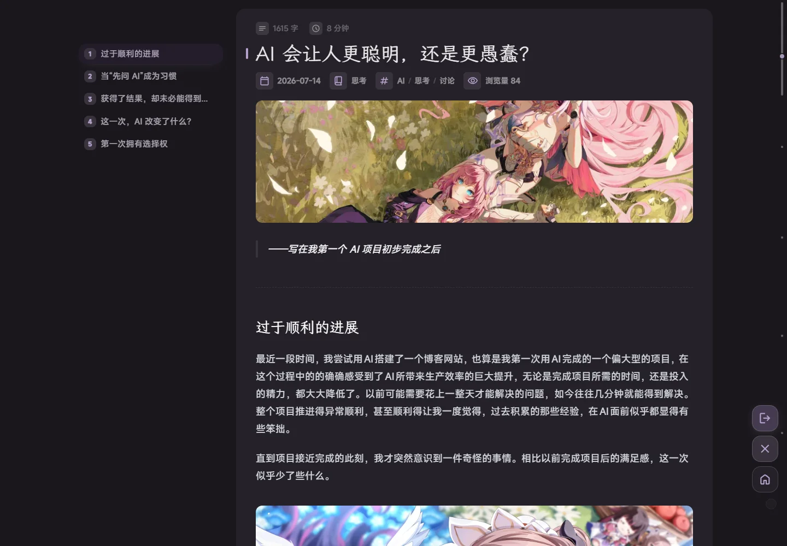
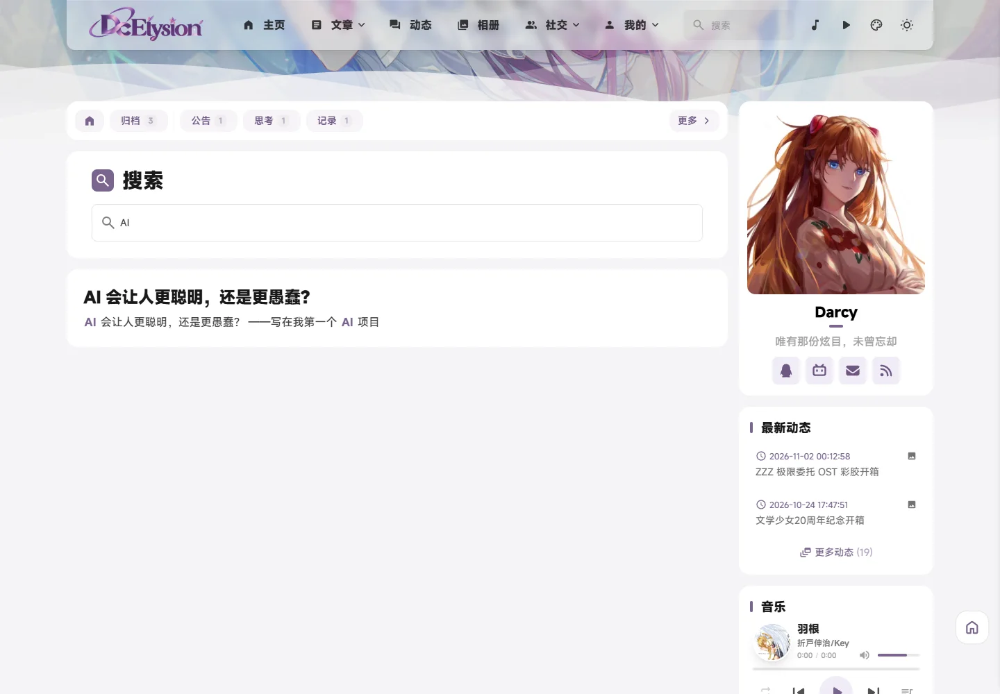
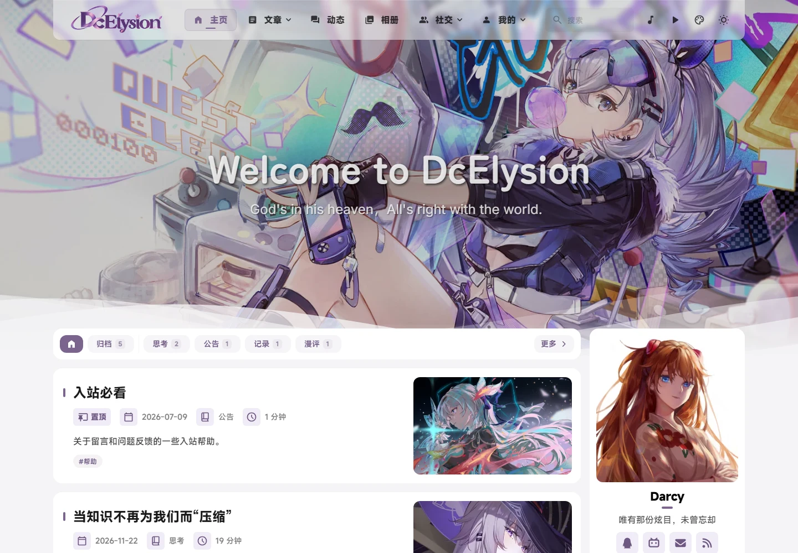
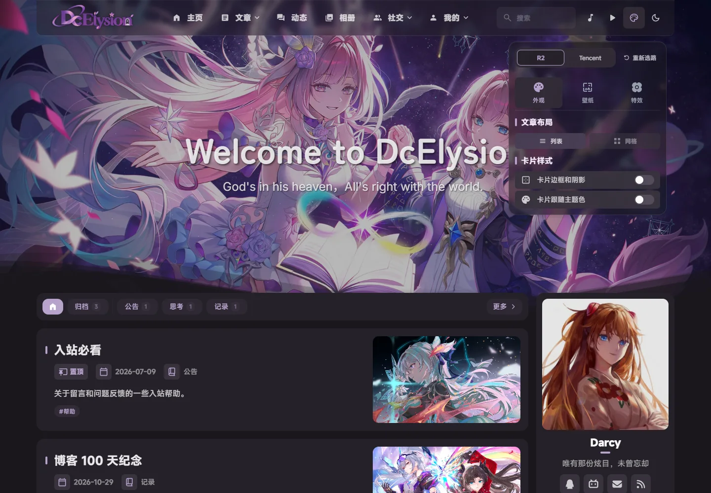
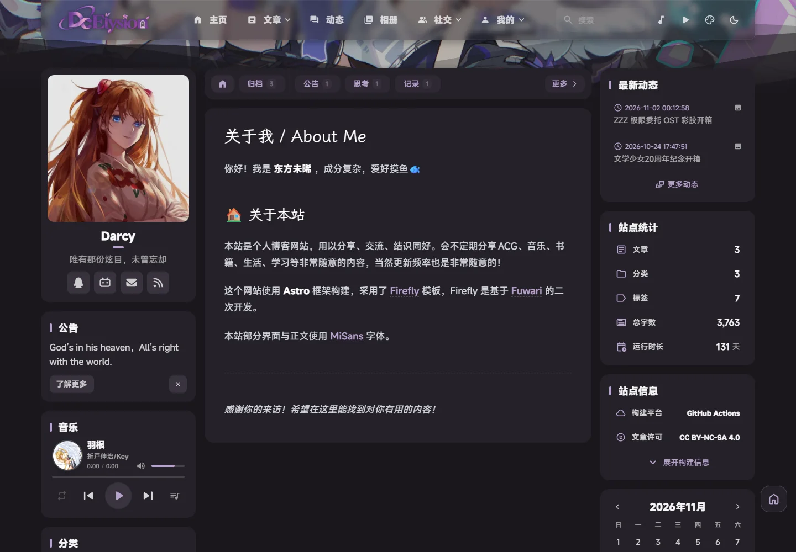
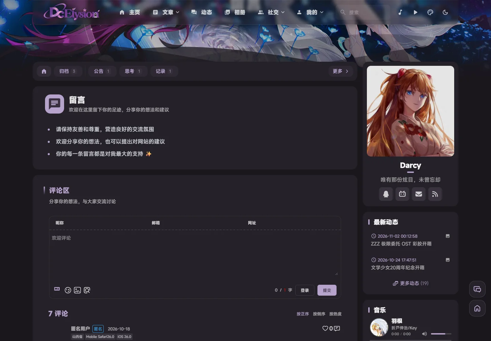

<div align="center">


# DcElysion Blog

**东方未晞的个人博客 · 唯有那份炫目，未曾忘却**

写长文，晒唱片，也记下最近喜欢的作品。第一次来，可以先读一篇文章，或去动态看看近况。

[访问博客](https://blog.dcelysion.cn/) · [个人主页](https://dcelysion.cn/) · [订阅更新](https://blog.dcelysion.cn/rss/) · [反馈问题](https://github.com/Darcy-1024/dcelysion-blog/issues)


</div>


## 在这里，可以做什么

| 入口 | 可以做什么 |
| --- | --- |
| 📖 [读文章](https://blog.dcelysion.cn/archive/) | 看建站记录和随笔，按年份、分类或标签找旧文。 |
| 🌸 [看动态](https://blog.dcelysion.cn/dynamic/) | 翻翻近况、开箱和随手拍下的照片。 |
| 🖼️ [逛相册](https://blog.dcelysion.cn/gallery/) | 从封面挑一本感兴趣的相册，按主题看照片。 |
| 🎮 [Bangumi](https://blog.dcelysion.cn/bangumi/) · [VNDB](https://blog.dcelysion.cn/vndb/) | 看看我的番组和视觉小说收藏。 |
| 🎵 音乐与外观 | 点导航栏的音符选首歌，或在显示设置里换成习惯的配色和布局。 |
| 💬 [友链](https://blog.dcelysion.cn/friends/) · [留言板](https://blog.dcelysion.cn/guestbook/) | 去朋友的小站串门，或者留下几句话。 |

## 文章，从这里读起

[《AI 会让人更聪明，还是更愚蠢？》](https://blog.dcelysion.cn/posts/ai-smarter-or-dumber/)写在我第一次用 AI 搭完博客之后。[《博客 100 天纪念》](https://blog.dcelysion.cn/posts/博客100天纪念/)则回过头，讲这个站是怎么一点点变成现在这样的。

每篇文章开头都能看到预计阅读时间。读到一半想跳过某一节，可以点右侧目录；碰到成系列的文章，读完还能接着看下一篇。


### 沉浸阅读

读长文时可以打开沉浸阅读，把横幅、导航和侧栏收起来。章节目录仍可按需展开；退出时会回到进入前的阅读位置。



### 归档与搜索

记得大概是哪一年写的，就从[归档](https://blog.dcelysion.cn/archive/)按时间翻；只记得正文里的一句话，就用[全文搜索](https://blog.dcelysion.cn/search/)。结果里会显示匹配到的片段，不必逐篇点开确认。

<table><tr>
<td width="50%"></td>
<td width="50%"></td>
</tr></table>

## 动态，最近在忙什么

一张《绝区零》原声黑胶的开箱照，或是周末碰上台风的几句碎碎念，都放在[动态](https://blog.dcelysion.cn/dynamic/)里。每条都有自己的链接，可以单独打开、评论，也可以生成海报分享。


## 相册，把照片放在一起

[相册](https://blog.dcelysion.cn/gallery/)按主题整理。可以顺着封面慢慢挑，也可以用关键词或标签缩小范围。点进一本，横图和竖图就按各自的比例排开。

<table><tr>
<td width="50%"></td>
<td width="50%"></td>
</tr></table>

## 作品收藏

### Bangumi · 番组计划

[番组计划](https://blog.dcelysion.cn/bangumi/)收着我关注的作品。先选感兴趣的类别，再按收藏状态翻，就能把已经看过的和还想补的分开。

### VNDB · 视觉小说

视觉小说单独放在 [VNDB 收藏](https://blog.dcelysion.cn/vndb/)里。可以按封面认作品，也可以只看想玩、在玩或已玩的条目。


## 音乐，挑一首再往下读

点导航栏的音符，或从侧栏打开播放器，就能展开歌单。想重听刚才那一句，可以拖动进度条；想跟着唱，就看看歌词。


## 外观，按自己的习惯来

首页文章可以一篇篇纵向排列，也可以换成网格。浅色、深色或跟随系统都在显示设置里；如果喜欢背景壁纸，还可以调整卡片透明度，让背景多露出一点。

<table><tr>
<td width="50%"></td>
<td width="50%"></td>
</tr></table>

### 在手机上看

到了小屏幕上，首页换用竖幅壁纸，文章卡片改为单列。想从文章跳去相册，展开导航菜单就能找到入口。

<p align="center"></p>

## 关于我，也关于这个站

想知道屏幕另一边是谁，可以从[关于页](https://blog.dcelysion.cn/about/)认识我。博客之外，还有一个能换壁纸、听音乐的[个人主页](https://dcelysion.cn/)。



### 友链

[友链](https://blog.dcelysion.cn/friends/)里是其他人的个人站点。挑一张卡片就能去串门；如果你也写博客，页面里有本站资料和交换链接的说明。


### 留言板

和某篇文章有关的想法，可以直接写在文末。不知道该发在哪里的话，或者只是想打声招呼，就来[留言板](https://blog.dcelysion.cn/guestbook/)。



### 订阅更新

不想错过新文章，可以去[订阅页](https://blog.dcelysion.cn/rss/)复制 RSS 或 Atom 地址，加到自己常用的阅读器里。

## 实现上的小细节

- **围绕个人内容持续维护**：基于 [Firefly](https://github.com/CuteLeaf/Firefly) 二次开发，使用 Astro、Svelte、TypeScript 和 Tailwind CSS，承载文章、动态、相册与收藏。
- **连贯的站内浏览**：使用 Swup 局部导航，串起不同页面的阅读体验。
- **全文搜索**：使用 Pagefind 生成搜索索引，通过标题与命中片段定位内容。
- **内容与工具放在一起**：仓库包含博客源码、配套内容管理后台，以及内容创建、媒体处理和构建脚本。

## 本地运行

需要 **Node.js ≥ 22.23.0** 与 Corepack；包管理器固定为 **pnpm 11.22.0**，具体版本以 [package.json](package.json) 为准。

```sh
git clone https://github.com/Darcy-1024/dcelysion-blog.git
cd dcelysion-blog
corepack pnpm install --frozen-lockfile
corepack pnpm dev
```

打开开发服务器输出的本地地址，默认是 [localhost:4321](http://localhost:4321/)。

| 命令 | 用途 |
| --- | --- |
| `corepack pnpm dev` | 启动博客开发服务器 |
| `corepack pnpm check` | 运行 Astro 检查 |
| `corepack pnpm build` | 构建博客并生成搜索索引等资源 |
| `corepack pnpm preview` | 预览构建结果 |
| `corepack pnpm new-post <name>` | 创建文章 |
| `corepack pnpm admin:dev` | 启动配套后台开发服务，需另行配置环境 |

构建所需的外部依赖与注意事项见[构建与验证](docs/agent-reference/build.md)。

## 换成自己的博客

站点信息、导航、外观与功能设置集中在 [`src/config/`](src/config/README.md)，文章与动态等内容放在 `src/content/`。

```text
src/
├── components/     页面组件、侧边栏与播放器
├── config/         站点、导航、外观与功能配置
├── content/        文章、动态等内容
└── pages/          博客页面与订阅入口
admin/              配套内容管理后台
public/             静态资源
scripts/            内容创建、媒体处理与构建脚本
docs/               项目文档与页面截图
```

本仓库包含个人站点配置。复用时请替换站点资料、个人内容、媒体地址与服务配置，并使用自己有权发布的素材。配套后台需要单独配置和运行。

配置方法见[配置文件说明](src/config/README.md)，内容维护见[工作流参考](docs/agent-reference/workflows.md)，音乐、相册与媒体配置见[媒体约定](docs/agent-reference/media.md)。

## 致谢与素材说明

感谢 [CuteLeaf / Firefly](https://github.com/CuteLeaf/Firefly) 提供主题基础，以及它所基于的 [saicaca / Fuwari](https://github.com/saicaca/fuwari)。也感谢 [Astro](https://astro.build/)、[Svelte](https://svelte.dev/)、[Tailwind CSS](https://tailwindcss.com/)、[Swup](https://swup.js.org/)、[Pagefind](https://pagefind.app/) 等开源项目。

站点使用 [MiSans](https://hyperos.mi.com/font/faq) 与[霞鹜文楷](https://github.com/lxgw/LxgwWenKai)。文章、图片、音乐、字体及其他第三方素材的权利归各自权利人所有，使用时请遵循对应授权；流萤相关素材归《崩坏：星穹铁道》及其权利人所有。

代码许可证见 [LICENSE](LICENSE)，保留原作者版权声明：

- Copyright (c) 2024 saicaca
- Copyright (c) 2025 CuteLeaf

仓库内其他语言的 README 保留上游主题说明，DcElysion 项目介绍以本页为准。
