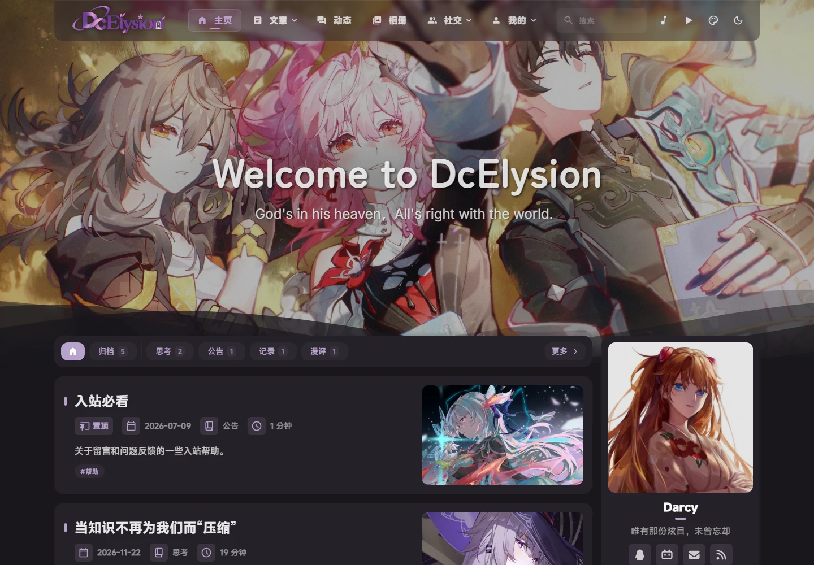
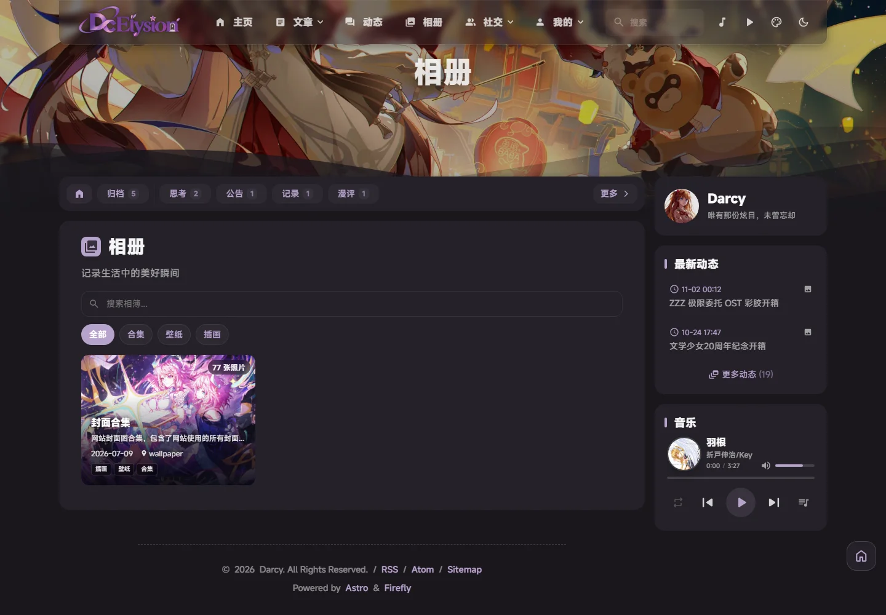
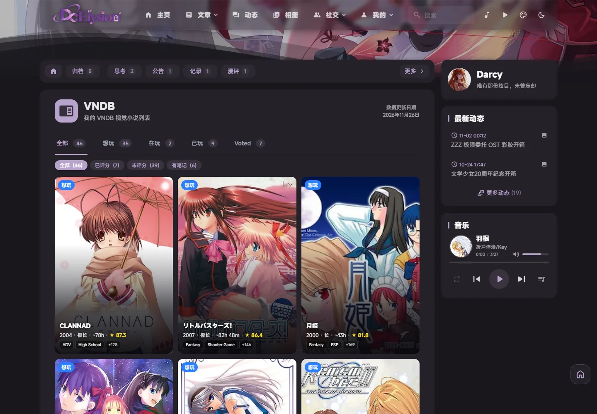

<div align="center">


# DcElysion Blog

**Darcy 的个人博客 · 唯有那份炫目，未曾忘却**

写下一些想法，收藏一些喜欢，也给平凡的日常留一个位置。

[访问博客](https://blog.dcelysion.cn/) · [个人主页](https://dcelysion.cn/) · [订阅更新](https://blog.dcelysion.cn/rss/) · [反馈问题](https://github.com/Darcy-1024/dcelysion-blog/issues)


</div>



## 在这里，可以做什么

| | 体验 |
| --- | --- |
| 📖 读点文字 | 浏览文章，按分类与标签寻找内容，用目录跳转章节，打开沉浸阅读专心读长文。 |
| 🌸 看看日常 | 翻阅图文动态，按关键词与年份回看，点赞、评论或分享一条记录。 |
| 🖼️ 逛逛相册 | 从一张封面走进相册，在瀑布流里慢慢浏览照片。 |
| 🎮 发现同好 | 浏览 Bangumi 与 VNDB 收藏，看看喜欢的 ACGN 作品。 |
| 🎵 听一首歌 | 打开播放器，选择曲目、调整进度与音量，查看歌单和歌词。 |
| ✨ 换个模样 | 切换浅深色、文章布局与壁纸，让页面更贴近自己的阅读习惯。 |
| 💬 留句话 | 认识作者、逛逛友链，或者在留言板打个招呼。 |

## 读一篇文章，慢慢往下翻

从首页挑一篇感兴趣的文章，让文字陪你待一会儿。MiSans 正文与霞鹜文楷标题，搭配舒展的留白；开篇可以了解分类、标签和预计阅读时间，章节目录帮助快速找到想读的部分。


想专心一点，就打开沉浸阅读。导航、横幅和侧栏杂项收起，正文拥有更多空间，目录仍可随时开合。退出时回到进入前的阅读位置，阅读模式偏好也会被记住。


读完后，可以沿着系列导航继续阅读，也可以点赞、分享或留下评论。

## 找回记忆中的那段文字

记得时间，就沿着归档回看；只记得几个词，就交给全文搜索。分类、标签与搜索结果里的命中片段，帮助你重新找到那篇文章。

<table>
  <tr>
    <td width="50%"></td>
    <td width="50%"></td>
  </tr>
  <tr>
    <td align="center">沿着时间回看</td>
    <td align="center">从几个关键词找起</td>
  </tr>
</table>

## 日常不必很长，也值得留下

短想法、开箱和生活片段，连同随手拍下的照片，都放在动态里。可以按关键词与年份翻找，也可以打开某一条的独立详情，分享链接或生成海报，把这一刻带给别人。


照片多一点，就收进相册。按封面挑选主题，用关键词与标签缩小范围，再让横图与竖图按各自的比例展开。

<table>
  <tr>
    <td width="50%"></td>
    <td width="50%"></td>
  </tr>
  <tr>
    <td align="center">从封面选一段回忆</td>
    <td align="center">走进照片里的风景</td>
  </tr>
</table>

## 喜欢的作品，和此刻想听的歌

这里也收藏着喜欢的 ACGN 作品。通过 Bangumi 与 VNDB 页面，按类别或收藏状态浏览，看看想玩、在玩与已玩的作品，也许能找到一点共同爱好。



阅读时想听点音乐，可以点开导航栏的音符，或使用侧栏播放器。选曲、切歌、调整进度与音量，展开歌单与歌词，让音乐陪着页面一起往下翻。


## 换成自己喜欢的阅读模样

浅色、深色，或跟随系统。显示设置里还可以切换文章列表与网格，调整卡片边框、阴影、壁纸与透明度，找到看着舒服的样子。

<table>
  <tr>
    <td width="50%"></td>
    <td width="50%"></td>
  </tr>
  <tr>
    <td align="center">明亮一点，或安静一点</td>
    <td align="center">按自己的习惯调整</td>
  </tr>
</table>

手机上也能继续逛。竖幅壁纸、单列文章卡片与紧凑导航，让内容顺着屏幕展开；菜单收进抽屉，常用入口仍然触手可及。

<p align="center">
  
</p>

## 串串门，也留句话

从[关于页](https://blog.dcelysion.cn/about/)认识作者和这个小站，也可以去友链看看其他人的世界。想交换链接，按页面说明留下站点信息；有建议、有想法，或者只是路过，都欢迎在留言板打个招呼。

<table>
  <tr>
    <td width="50%"></td>
    <td width="50%"></td>
  </tr>
  <tr>
    <td align="center">认识更多个人站点</td>
    <td align="center">留下一点来过的痕迹</td>
  </tr>
</table>

## 实现上的小细节

- **围绕个人内容持续维护**：基于 [Firefly](https://github.com/CuteLeaf/Firefly) 二次开发，使用 Astro、Svelte、TypeScript 和 Tailwind CSS，承载文章、动态、相册与收藏。
- **连贯的站内浏览**：使用 Swup 局部导航，串起不同页面的阅读体验。
- **全文搜索**：使用 Pagefind 生成搜索索引，通过标题与命中片段定位内容。
- **内容与工具放在一起**：仓库包含博客源码、配套内容管理后台，以及内容创建、媒体处理和构建脚本。

## 本地运行

需要 **Node.js ≥ 22.23.0** 与 Corepack；包管理器固定为 **pnpm 11.22.0**，具体版本以 [package.json](package.json) 为准。

```sh
git clone https://github.com/Darcy-1024/dcelysion-blog.git
cd dcelysion-blog
corepack pnpm install --frozen-lockfile
corepack pnpm dev
```

打开开发服务器输出的本地地址，默认是 [localhost:4321](http://localhost:4321/)。

| 命令 | 用途 |
| --- | --- |
| `corepack pnpm dev` | 启动博客开发服务器 |
| `corepack pnpm check` | 运行 Astro 检查 |
| `corepack pnpm build` | 构建博客并生成搜索索引等资源 |
| `corepack pnpm preview` | 预览构建结果 |
| `corepack pnpm new-post <name>` | 创建文章 |
| `corepack pnpm admin:dev` | 启动配套后台开发服务，需另行配置环境 |

构建所需的外部依赖与注意事项见[构建与验证](docs/agent-reference/build.md)。

## 换成自己的博客

站点信息、导航、外观与功能设置集中在 [`src/config/`](src/config/README.md)，文章与动态等内容放在 `src/content/`。

```text
src/
├── components/     页面组件、侧边栏与播放器
├── config/         站点、导航、外观与功能配置
├── content/        文章、动态等内容
└── pages/          博客页面与订阅入口
admin/              配套内容管理后台
public/             静态资源
scripts/            内容创建、媒体处理与构建脚本
docs/               项目文档与页面截图
```

本仓库包含个人站点配置。复用时请替换站点资料、个人内容、媒体地址与服务配置，并使用自己有权发布的素材。配套后台需要单独配置和运行。

配置方法见[配置文件说明](src/config/README.md)，内容维护见[工作流参考](docs/agent-reference/workflows.md)，音乐、相册与媒体配置见[媒体约定](docs/agent-reference/media.md)。

## 致谢与素材说明

感谢 [CuteLeaf / Firefly](https://github.com/CuteLeaf/Firefly) 提供主题基础，以及它所基于的 [saicaca / Fuwari](https://github.com/saicaca/fuwari)。也感谢 [Astro](https://astro.build/)、[Svelte](https://svelte.dev/)、[Tailwind CSS](https://tailwindcss.com/)、[Swup](https://swup.js.org/)、[Pagefind](https://pagefind.app/) 等开源项目。

站点使用 [MiSans](https://hyperos.mi.com/font/faq) 与[霞鹜文楷](https://github.com/lxgw/LxgwWenKai)。文章、图片、音乐、字体及其他第三方素材的权利归各自权利人所有，使用时请遵循对应授权；流萤相关素材归《崩坏：星穹铁道》及其权利人所有。

代码许可证见 [LICENSE](LICENSE)，保留原作者版权声明：

- Copyright (c) 2024 saicaca
- Copyright (c) 2025 CuteLeaf

仓库内其他语言的 README 保留上游主题说明，DcElysion 项目介绍以本页为准。
