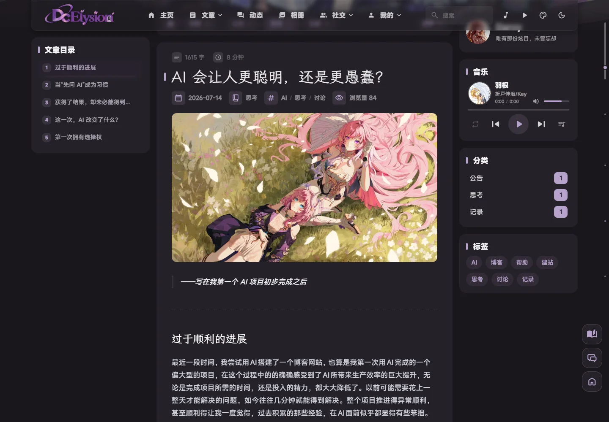
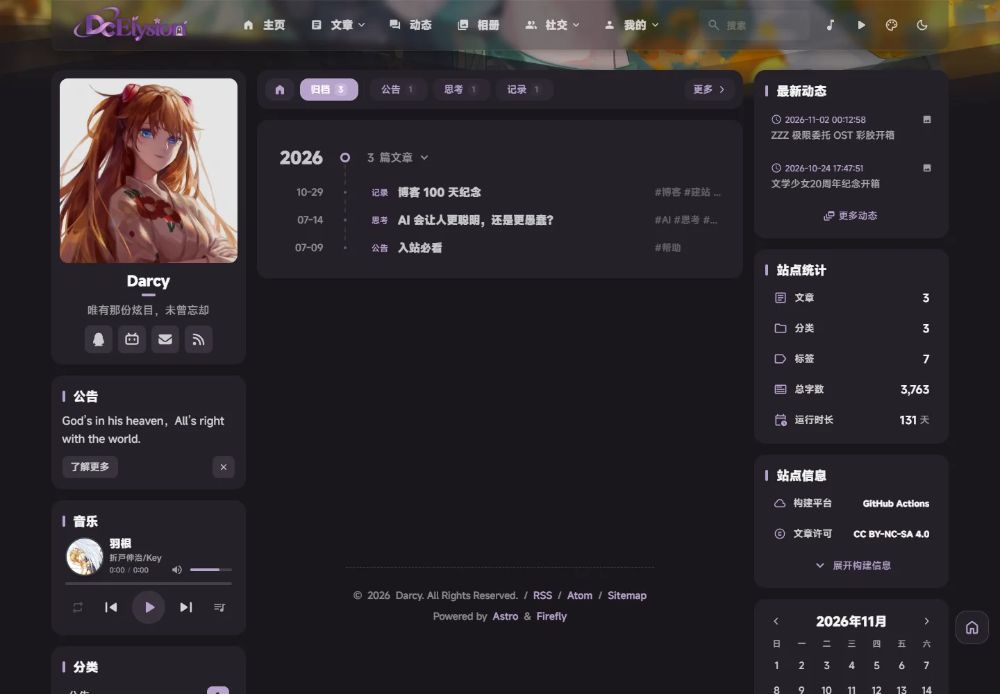
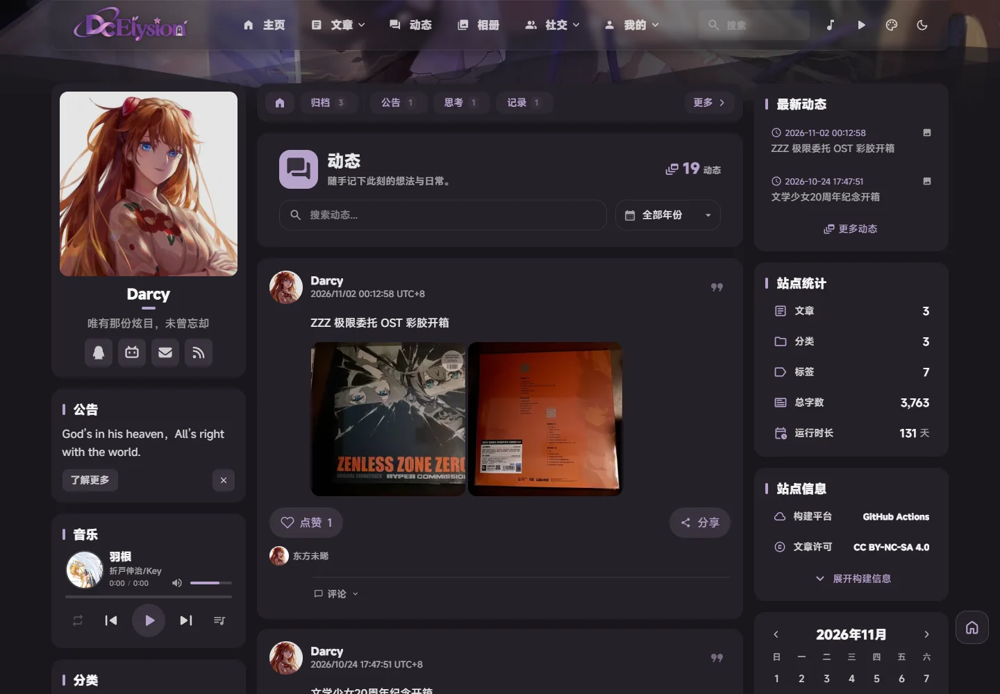
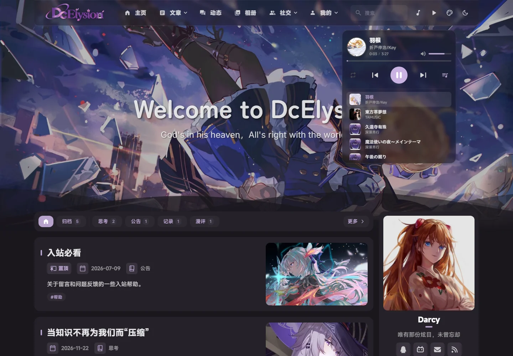
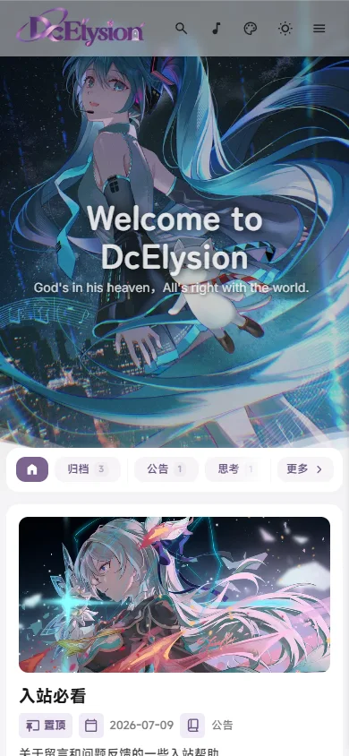

<div align="center">


# DcElysion Blog

**东方未晞的个人博客 · 唯有那份炫目，未曾忘却**

这里是我在互联网上的一处自留地。平时会在上面写写长文与漫评，晒晒刚到的黑胶唱片，也整理自己看过的番剧、推过的视觉小说和随手拍下的照片。

[访问博客](https://blog.dcelysion.cn/) · [个人主页](https://dcelysion.cn/) · [订阅更新](https://blog.dcelysion.cn/rss/) · [本地运行与复用](#本地运行) · [反馈问题](https://github.com/Darcy-1024/dcelysion-blog/issues)

**简体中文** · [English](README.en.md)


</div>


## 站点导览

| 栏目 | 这里放了什么 |
| --- | --- |
| 📖 [文章](https://blog.dcelysion.cn/archive/) | 深度漫评、建站记录与日常随笔，支持按年份、分类或标签检索。 |
| 🌸 [动态](https://blog.dcelysion.cn/dynamic/) | 介于日记与朋友圈之间的日常碎片、唱片开箱与生活近况。 |
| 🖼️ [相册](https://blog.dcelysion.cn/gallery/) | 按主题收纳的摄影与画面，点进封面即可按原图比例浏览。 |
| 🎮 [Bangumi](https://blog.dcelysion.cn/bangumi/) · [VNDB](https://blog.dcelysion.cn/vndb/) | 我追过的动画番剧与推过的视觉小说，按观看与游玩状态归档。 |
| 💬 [友链](https://blog.dcelysion.cn/friends/) · [留言板](https://blog.dcelysion.cn/guestbook/) | 去朋友的独立小站串门，或者在留言板打声招呼。 |

## 文章，从这里读起

一些灵光一现的念头、折腾技术的记录，或是看完某部作品后不吐不快的长评，都会沉淀在这里。如果你是第一次来，不妨从这几篇读起：

- 🎬 **[《从不喊“欧尼酱”的她，为何却成为十几年来无法超越的妹系经典？》](https://blog.dcelysion.cn/posts/yosuga-no-sora-kasugano-sora/)** —— 从《缘之空》与《悠之空》回看春日野穹，聊聊她身上那场关于依存、异化与重生的浪漫主义悲剧。
- 🤔 **[《AI 会让人更聪明，还是更愚蠢？》](https://blog.dcelysion.cn/posts/ai-smarter-or-dumber/)** —— 第一次借助 AI 从零搭完博客之后，留下的一点思考。
- 🎂 **[《博客 100 天纪念》](https://blog.dcelysion.cn/posts/博客100天纪念/)** —— 一篇迟来的百日回顾，记录这个小站是怎么从最初的“毛坯房”一点点打磨成现在这样的。

对于一个博客而言，最重要的终究还是阅读本身的体验。因此我在文章排版、本地字体与章节导航上做了不少减法——开启**沉浸阅读**后，可以一键收起顶部横幅、导航栏与两侧边栏，剥离多余的视觉干扰，让视线与注意力重新回到文字本身；退出时也会稳稳回到刚才读到的位置。

<table><tr>
<td width="50%"></td>
<td width="50%"></td>
</tr></table>

如果想翻看旧文，除了在 [归档](https://blog.dcelysion.cn/archive/) 里顺着时间线梳理，也可以直接用站内的 [全文搜索](https://blog.dcelysion.cn/search/)。哪怕只记得正文里的半句话，搜索结果也会直接高亮展示命中的上下文片段，省去逐篇点开确认的麻烦。

<table><tr>
<td width="50%"></td>
<td width="50%"></td>
</tr></table>

## 动态与相册，收纳日常的碎片

那些不足以铺陈成万字长文的转瞬即逝，都落在了这两个角落：

我会把 **[动态](https://blog.dcelysion.cn/dynamic/)** 看作“日记与朋友圈的结合体”。无论是刚收到的《绝区零》原声黑胶开箱照，还是周末碰上台风时的几句碎碎念，都可以随手记录下来。每条动态都有独立的详情页与评论区，也能一键生成带配图的海报卡片方便分享。



**[相册](https://blog.dcelysion.cn/gallery/)** 则按主题整理了平时拍下的照片与喜欢的视觉画面。可以顺着封面和标签慢慢挑；点进其中一本后，横图与竖图会按照各自的画幅比例自然排开。

<table><tr>
<td width="50%"></td>
<td width="50%"></td>
</tr></table>

## 番组与视觉小说收藏

作为一个常年浸染在二次元里的玩家与观众，我也把自己的精神食粮搬到了博客上。

看过的动画与番剧整理在 **[Bangumi 番组计划](https://blog.dcelysion.cn/bangumi/)**，推过的 Galgame 则单独收在 **[VNDB 视觉小说](https://blog.dcelysion.cn/vndb/)** 页。每一部作品都配有直观的封面墙，并按“想看 / 在看 / 看过（或已玩）”分好了状态——既是给自己留一份足迹归档，也方便路过的同好对对电波。


## 音乐与外观：一点关于视听的执念

我对站点的音乐和视觉呈现始终有些执念。导航栏和侧栏里的播放器塞满了我平时写字或发呆时常听的曲子，在保留高音质音频与动态视频壁纸的同时，也尽量兼顾了加载速度；得益于站内的无刷新局部跳转，翻看不同页面时音乐也不会中断，可以挑一首伴着慢慢逛。



如果你对阅读界面有自己的偏好，可以在显示设置里把首页文章从单列切换为网格、调整深浅色主题，或是拉动卡片透明度，让底下的背景壁纸多透出来一点。到了小屏手机上，首页也会自动换用竖幅壁纸与单列卡片。

<table><tr>
<td width="50%"></td>
<td width="50%"></td>
</tr></table>

<p align="center"></p>

## 认识我，或者留下脚印

想知道屏幕另一边是谁，可以从 **[关于页](https://blog.dcelysion.cn/about/)** 认识我。博客之外，我还搭了一个延续同套视觉风格、能换壁纸听歌的独立 **[个人主页](https://dcelysion.cn/)**，作为整张个人网络名片的门面。


**[友链](https://blog.dcelysion.cn/friends/)** 里收集了许多朋友的独立小站，挑一张卡片就能去串门；如果你也维护着自己的博客，页面下方附有本站资料与交换链接的说明。

和某篇文章有关的想法可以直接写在文末；如果只是路过想打声招呼，或者有不知道该发在哪里的话，就来 **[留言板](https://blog.dcelysion.cn/guestbook/)** 坐坐——评论区支持注册登录与点赞互动，同时也完整保留了最低门槛的匿名留言。习惯用阅读器追更的朋友，则可以在 **[订阅页](https://blog.dcelysion.cn/rss/)** 直接复制 RSS 或 Atom 地址。

<table><tr>
<td width="50%"></td>
<td width="50%"></td>
</tr></table>

---

## 幕后与技术细节

- **围绕个人表达持续打磨**：基于 [Firefly](https://github.com/CuteLeaf/Firefly) 主题深度定制，底层采用 Astro、Svelte、TypeScript 与 Tailwind CSS 构建，逐步扩展出动态、相册、Bangumi / VNDB 收藏与沉浸式阅读模式。
- **连贯的视听与浏览**：通过 Swup 实现站内局部导航，切换页面时音乐播放与阅读状态平滑衔接；配合 Pagefind 提供带命中片段预览的静态全文搜索。
- **完整的互动与管理闭环**：接入自托管的 Waline 评论与账号体系，支持 Memos 动态联动；仓库内同时包含配套的可视化管理后台（`admin/`），以及内容创建、媒体处理与多线路资源分发脚本。

## 本地运行

本地开发需要 **Node.js ≥ 22.23.0** 与 Corepack；包管理器固定为 **pnpm 11.22.0**，具体依赖版本以 [package.json](package.json) 为准。

```sh
git clone https://github.com/Darcy-1024/dcelysion-blog.git
cd dcelysion-blog
corepack pnpm install --frozen-lockfile
corepack pnpm dev
```

启动后访问终端输出的本地地址（默认为 [localhost:4321](http://localhost:4321/)）。

| 常用命令 | 说明 |
| --- | --- |
| `corepack pnpm dev` | 启动博客本地开发服务器 |
| `corepack pnpm check` | 运行 Astro 类型与语法检查 |
| `corepack pnpm build` | 构建静态站点并生成 Pagefind 搜索索引等资源 |
| `corepack pnpm preview` | 在本地预览构建后的静态产物 |
| `corepack pnpm new-post <name>` | 使用模板创建一篇新文章 |
| `corepack pnpm admin:dev` | 启动配套内容管理后台（需单独配置环境） |

构建所需的外部依赖与排障方法见 [构建与验证](docs/agent-reference/build.md)。

## 换成自己的博客

站点资料、导航栏、外观与功能开关集中在 [`src/config/`](src/config/README.md)，文章与动态等 Markdown 内容放在 `src/content/`。

```text
src/
├── components/     页面组件、侧边栏与音乐播放器
├── config/         站点信息、导航、外观与功能配置
├── content/        文章与动态内容
└── pages/          页面路由与 RSS / Atom 订阅入口
admin/              配套可视化内容管理后台
public/             字体、图标等静态资源
scripts/            内容创建、媒体处理与构建辅助脚本
docs/               项目参考文档与页面截图
```

本仓库保存着我自己的线上站点配置。如果你想基于它搭建自己的博客，请先替换站点资料、个人文章与动态、媒体域名及第三方服务配置，并仅使用你有权发布的素材。

详细配置项见 [配置文件说明](src/config/README.md)，日常内容维护见 [工作流参考](docs/agent-reference/workflows.md)，音乐、相册与存储配置见 [媒体约定](docs/agent-reference/media.md)。

## 部署

`corepack pnpm build` 会将整个博客编译为纯静态文件输出到 `dist/`，任何支持静态托管的平台都可以直接部署。仓库内已附带以下平台的配置：

| 平台 | 配置文件 | 说明 |
| --- | --- | --- |
| Vercel | [`vercel.json`](vercel.json) | 导入仓库后通过 `pnpm build` 构建并发布 `dist/`，内置安全响应头与静态资源长缓存。 |
| Cloudflare Workers | [`wrangler.jsonc`](wrangler.jsonc) | 将 `dist/` 作为静态资源托管发布。 |
| GitHub Pages | [`deploy.yml`](.github/workflows/deploy.yml) | 推送到 `master` 分支后自动完成部署。 |
| EdgeOne Pages | [`edgeone.json`](edgeone.json) | 发布 `dist/`，并为多线路探测文件配置响应头。 |

本站线上采用**“单次构建、多端分发”**流程：推送到 `master` 后，[`public-blog.yml`](.github/workflows/public-blog.yml) 会在 GitHub Actions 中执行一次完整构建，并将公开静态产物打包发布为 `blog-<提交 SHA>` Release；随后 GitHub Pages、Cloudflare 与 EdgeOne 直接拉取并校验同一份 Release 产物上线，避免多平台重复构建。Release 产物仅包含公开站点文件，不包含管理后台与任何私有数据。

<details>
<summary><strong>Fork 部署提示与可选环境变量（点击展开）</strong></summary>

<br />

> [!NOTE]
> 如果你 Fork 本仓库后自行部署，请注意 `deploy.yml` 与 `edgeone.json` 默认会从本仓库的 Release 下载构建产物（地址定义在 [`scripts/download-blog-release.mjs`](scripts/download-blog-release.mjs)）。建议在你的托管平台将构建命令改为 `pnpm build`、输出目录设为 `dist`；或者修改下载地址，让 `public-blog.yml` 在你自己的仓库里发布 Release。

构建时支持通过以下环境变量覆盖默认配置（均为可选）：

| 变量名 | 作用 |
| --- | --- |
| `PUBLIC_SITE_LANG` | 覆盖站点语言（如 `en`）；未设置时读取配置文件中的语言。 |
| `PUBLIC_DISPLAY_SETTINGS` | 覆盖显示设置面板的开关状态（`true` / `false`）。 |
| `GITHUB_TOKEN` | 构建文章内的 GitHub 仓库卡片时用于拉取仓库元数据，避免触发 API 匿名限流。 |
| `CF_WORKERS` | 在 Cloudflare Workers 环境构建时启用 `@astrojs/cloudflare` 适配器。 |

配套管理后台需要独立部署，所需环境变量见 [`admin/.env.example`](admin/.env.example)。

</details>

## 致谢与素材说明

感谢 [CuteLeaf / Firefly](https://github.com/CuteLeaf/Firefly) 提供主题基础，以及它所源自的 [saicaca / Fuwari](https://github.com/saicaca/fuwari)。同时也感谢 [Astro](https://astro.build/)、[Svelte](https://svelte.dev/)、[Tailwind CSS](https://tailwindcss.com/)、[Swup](https://swup.js.org/)、[Pagefind](https://pagefind.app/) 等开源项目。

站点正文字体采用 [MiSans](https://hyperos.mi.com/font/faq) 与 [霞鹜文楷](https://github.com/lxgw/LxgwWenKai)。博客内的文章、图片、音乐、字体及其他第三方素材权利归各自权利人所有，复用代码时请遵循对应授权协议；流萤相关视觉素材归《崩坏：星穹铁道》及其权利人所有。

项目代码基于 [LICENSE](LICENSE) 开源，保留原作者版权声明：

- Copyright (c) 2024 saicaca
- Copyright (c) 2025 CuteLeaf

[English README](README.en.md) 为本页的英文版本；`docs/` 目录下的繁体中文、日文与韩文文档保留上游 Firefly 主题说明，DcElysion 项目的介绍以本页为准。
