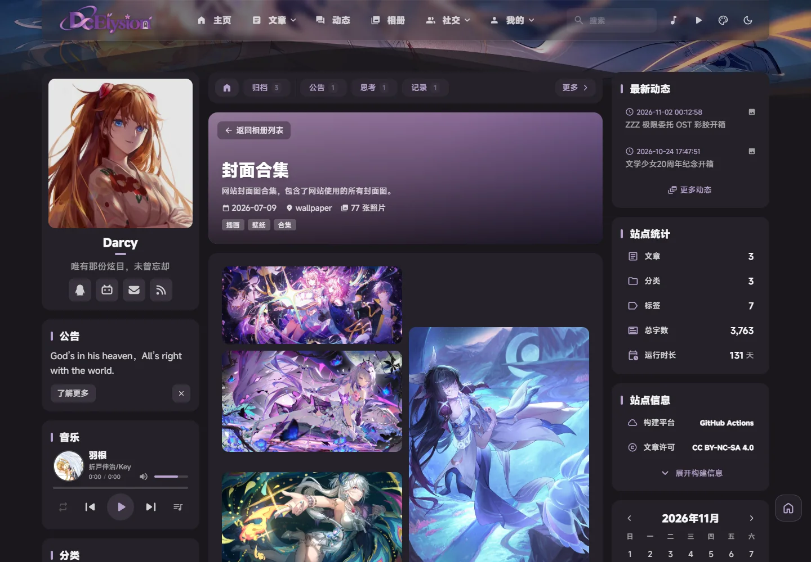
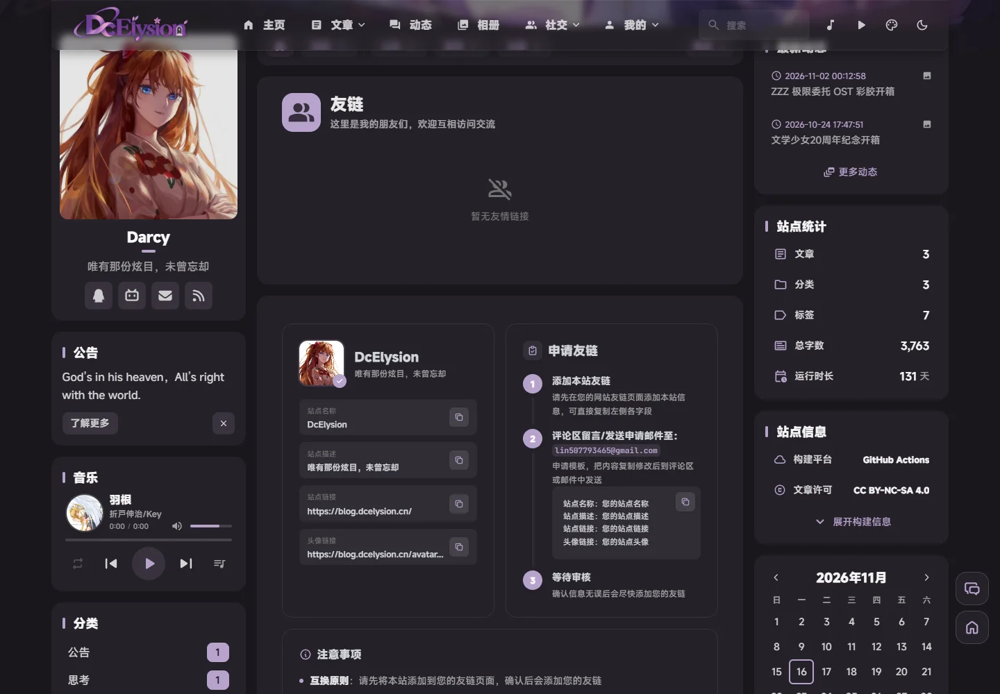

<div align="center">

# DcElysion

**Darcy 的个人博客 · 文章、生活记录与 ACGN 收藏**

唯有那份炫目，未曾忘却

[访问博客](https://blog.dcelysion.cn/) · [关于我](https://blog.dcelysion.cn/about/) · [订阅更新](https://blog.dcelysion.cn/rss/) · [反馈问题](https://github.com/Darcy-1024/dcelysion-blog/issues)

</div>

---

## 关于这个项目

DcElysion 是 Darcy 的个人博客，用来分享文章、记录日常，也收集喜欢的音乐、影像与 ACGN 作品。这个仓库保存博客源码及配套的内容管理工具，并围绕个人写作、阅读和内容发布持续维护。

项目基于 [Firefly](https://github.com/CuteLeaf/Firefly) 二次开发，使用 Astro、Svelte、TypeScript 和 Tailwind CSS。

## 界面与设计

从首页的第一眼，到读完一篇文章，再到随手翻阅动态和收藏，DcElysion 用紫色点缀、圆角卡片和统一的导航串起不同内容。下面的配图均来自本站实际页面，点击图片可查看大图。

### 首页 · 从一张横幅开始


大幅插画横幅承载欢迎语，半透明导航让背景延续到页面顶部。向下进入内容区后，文章与个人资料分别放在独立卡片中：封面带来直观印象，标题、摘要、日期与标签帮助读者决定下一篇读什么。

- **分类入口靠近文章**：主页、归档和分类集中在内容上方，查找文章不用返回导航菜单。
- **重要内容优先**：置顶文章带有明确标识，新访客可以先了解本站。
- **个人气息留在侧边**：头像、签名和社交入口与文章并列，让博客也成为认识作者的入口。

### 文章 · 标题有层次，正文有留白


文章页以正文卡片为中心，文楷标题与 MiSans 正文形成层次。日期、分类、标签、字数和预计阅读时间集中在开篇，封面与引文随后展开；章节目录帮助读者在长文中定位，页面边缘的章节标记提示阅读位置。

文章还提供系列导航、点赞、分享和评论入口，从阅读到交流可以在同一页完成。

### 沉浸阅读 · 给正文更多空间


点击文章页的沉浸阅读按钮，导航、横幅和侧栏杂项会收起，正文获得更宽的阅读空间。目录仍可辅助跳转，读者也可以开合目录；退出后回到进入前的阅读位置。阅读模式偏好会被记住，适合连续阅读长文。

### 归档与搜索 · 按时间回看，按关键词寻找

<table>
  <tr>
    <td width="50%"></td>
    <td width="50%"></td>
  </tr>
  <tr>
    <td align="center">年份时间线 · 日期、分类与标题并列</td>
    <td align="center">全文搜索 · 标题与命中片段一起呈现</td>
  </tr>
</table>

归档页将文章按年份和日期排列，轻量的时间线保留了写作顺序，也支持分类与标签筛选。搜索页则面向“记得一段内容，但不记得标题”的场景：输入关键词后，结果卡片显示标题与相关片段，点击即可继续阅读。

### 动态 · 让日常有自己的位置


短想法、开箱和生活片段以独立卡片排列。头像与时间标出记录的来源，多张照片组成紧凑图集，文字与图片之后才是点赞、分享和评论，让内容保持第一眼的重点。

- 通过关键词与年份筛选回看旧动态。
- 每条动态都有独立详情地址，可单独打开与分享。
- 评论可在卡片内展开，分享支持生成海报。

### 相册 · 从封面走进图片

<table>
  <tr>
    <td width="50%"></td>
    <td width="50%"></td>
  </tr>
  <tr>
    <td align="center">相册入口 · 封面、数量与标签</td>
    <td align="center">相册内页 · 保留图片比例的瀑布流</td>
  </tr>
</table>

相册列表用封面卡片概括主题，将名称、简介、照片数量和标签放在一起；关键词与标签用于缩小范围。进入相册后，图片按不同长宽比例交错排列，让横图与竖图都拥有自然的展示空间。

### ACGN 收藏 · 把喜欢的作品摆出来


VNDB 页面以封面网格展示视觉小说收藏，卡片上叠加名称、状态、评分与标签。上方的收藏分组和筛选把“想玩”“在玩”“已玩”等状态分开，便于从作品封面开始浏览，再进入感兴趣的条目。

本站也提供 Bangumi 番组计划页面，按作品类别和收藏状态组织内容。两类收藏沿用统一的卡片语言；上图展示的是 VNDB 页面。

### 音乐 · 浏览时随手打开


导航栏的音符按钮展开小型播放器，封面、曲名、歌手、进度与音量集中在一个浮层中。侧栏也提供播放器卡片，读者可以切歌、调整播放模式，或展开列表与歌词，在浏览内容的同时选择想听的音乐。

### 外观 · 浅深色与自己的阅读习惯

<table>
  <tr>
    <td width="50%"></td>
    <td width="50%"></td>
  </tr>
  <tr>
    <td align="center">浅色、深色或跟随系统</td>
    <td align="center">文章布局、卡片样式与壁纸设置</td>
  </tr>
</table>

浅色模式使用明亮底色与白色卡片，深色模式降低大面积背景亮度，两者都保留紫色强调。显示设置将外观、壁纸与特效分组，可选择文章列表或网格、调整卡片边框与阴影，以及壁纸模式、透明度等选项。

### 移动端 · 把内容收进一列

<p align="center">
  
</p>

小屏幕上，导航收起为菜单与常用图标，文章卡片改为单列，封面放在标题上方。竖幅壁纸与欢迎语保留首页的视觉印象，分类入口仍紧贴文章列表，便于用手机继续浏览。

### 友链与留言 · 留下交流的入口

<table>
  <tr>
    <td width="50%"></td>
    <td width="50%"></td>
  </tr>
  <tr>
    <td align="center">友链 · 站点信息与申请方式</td>
    <td align="center">留言 · 想法、建议与访客交流</td>
  </tr>
</table>

友链页将本站信息和申请步骤并排呈现，名称、描述、链接与头像地址可分别复制，方便交换链接。留言板把简短的交流说明放在评论区之前，提供一个不依附于某篇文章的公共交流空间。

### 关于 · 简单介绍这里与自己


关于页保留与文章一致的字体和留白，用简短正文介绍作者、分享方向和网站来源。侧栏的头像与签名延续个人身份，让访客从任何内容页来到这里，都能认出是同一个人的空间。


## 仓库内容

| 目录 | 内容 |
| --- | --- |
| `src/content/` | 文章、动态等内容 |
| `src/pages/` | 博客页面与订阅入口 |
| `src/components/` | 页面组件、侧边栏与播放器等功能 |
| `src/config/` | 站点、导航、外观及功能配置 |
| `admin/` | 配套内容管理后台 |
| `scripts/` | 内容创建、媒体处理与构建脚本 |
| `public/` | 静态资源 |

## 本地运行

需要 **Node.js >= 22.23.0**，使用项目固定的 **pnpm 11.22.0**。具体版本以 [package.json](package.json) 为准。

```bash
git clone https://github.com/Darcy-1024/dcelysion-blog.git
cd dcelysion-blog
corepack pnpm install
corepack pnpm dev
```

打开开发服务器输出的本地地址，默认是 `http://localhost:4321`。

| 命令 | 用途 |
| --- | --- |
| `corepack pnpm dev` | 启动博客开发服务器 |
| `corepack pnpm check` | 运行 Astro 检查 |
| `corepack pnpm build` | 构建博客并生成搜索索引等资源 |
| `corepack pnpm preview` | 预览已构建的博客 |
| `corepack pnpm new-post <name>` | 创建文章 |
| `corepack pnpm admin:dev` | 启动配套后台开发服务，需另行配置环境 |

站点配置见 [配置文件说明](src/config/README.md)，构建所需的外部依赖与注意事项见 [构建参考](docs/agent-reference/build.md)。本仓库包含个人站点配置；复用时请替换站点信息、内容及服务配置。

## 致谢

- [CuteLeaf / Firefly](https://github.com/CuteLeaf/Firefly)：本项目的上游主题，提供了博客的界面与功能基础。
- [saicaca / Fuwari](https://github.com/saicaca/fuwari)：Firefly 所基于的原始博客模板。
- [Astro](https://astro.build/)、[Svelte](https://svelte.dev/)、[Tailwind CSS](https://tailwindcss.com/)、[Swup](https://swup.js.org/)、[Pagefind](https://pagefind.app/) 及其他开源项目。
- [MiSans](https://hyperos.mi.com/font/faq) 与 [霞鹜文楷](https://github.com/lxgw/LxgwWenKai)：站点使用的字体。

仓库内保留的其他语言 README 为上游主题说明，尚未改写为 DcElysion 项目介绍；本项目介绍以本页为准。

## 许可与素材

代码许可证见 [LICENSE](LICENSE)，保留原作者版权声明：

- Copyright (c) 2024 saicaca
- Copyright (c) 2025 CuteLeaf

文章、图片、音乐、字体及其他第三方素材的权利归各自权利人所有，使用时请遵循对应授权。流萤相关素材归《崩坏：星穹铁道》及其权利人所有。
