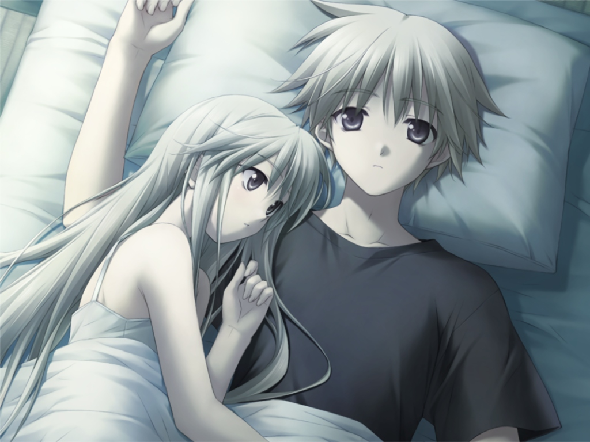
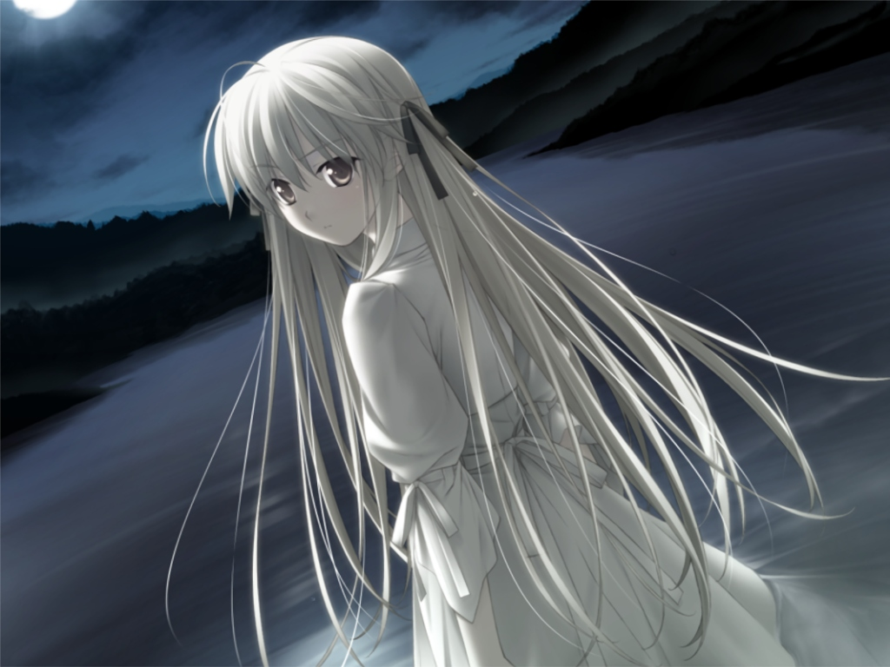
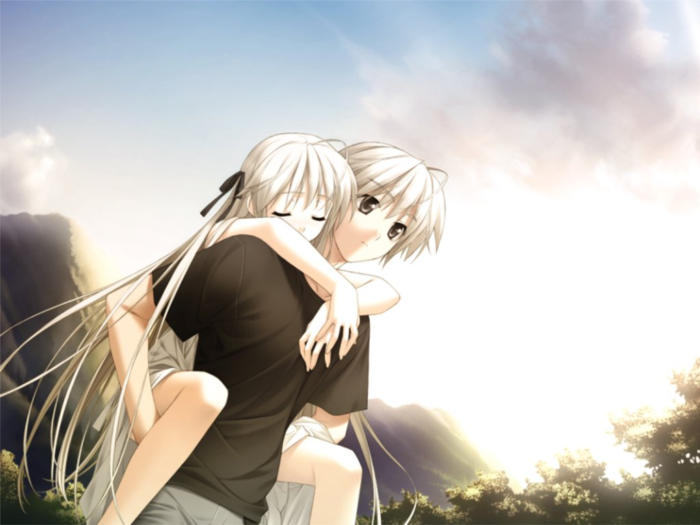
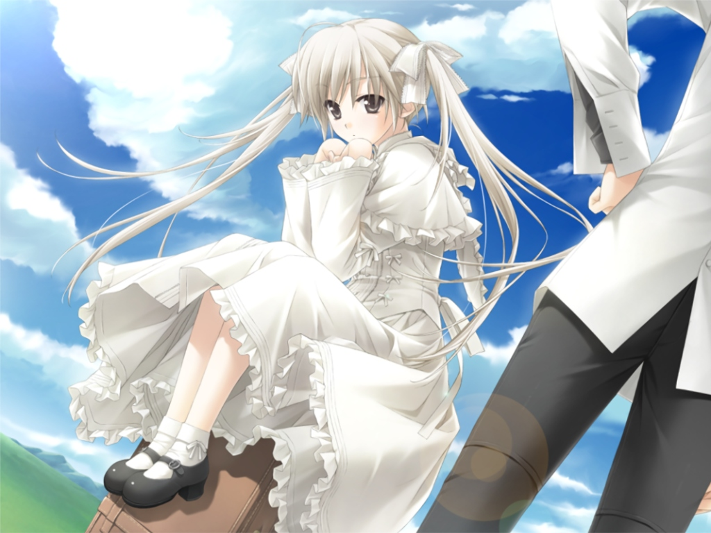

> “有妹恨妹不成穹，无妹恨穹不是妹。”

距离 2008 年 Sphere 社推出原作游戏《缘之空》（ヨスガノソラ），已经过去了十八年；距离 2010 年那部轰动业界的同名改编动画播出，也已经过去了整整十六年。

在更新换代快得近乎残酷的二次元世界里，十六年足以让几代“国民老婆”沦为时代的眼泪。这些年里，各种各样的妹系角色层出不穷：有任劳任怨、把哥哥生活起居照顾得无微不至的家务全能型妹妹；有表面傲娇毒舌、背地里收集哥哥一切周边的轻小说妹妹；也有乖巧软糯、把“欧尼酱（お兄ちゃん）”挂在嘴边的邻家义妹。

可见二次元里从来不缺漂亮的妹妹，也不缺黏着哥哥撒娇的工业糖精。

但那个脾气古怪、生活不能自理、甚至带着几分病态与偏执的**春日野穹**，究竟有何魅力能穿越十几年的漫长时光，始终稳坐“妹系天花板”的王座？

如果只用“白毛萝莉颜值高”或者“真骨科题材够刺激”来解释，显然低估了这个角色的重量。回看《缘之空》与续作《悠之空》的完整叙事就会发现：**真正让穹妹难以被替代的，是她跳出了供人消费的“萌系标签”，在奥木染那个蝉鸣不止的夏天里，完成了一场关于依存、异化与重生的极致浪漫主义悲剧。**

---

## 一、 不愿做“传统妹妹”

在谈论穹的感情之前，必须先看清她在“兄妹关系”里的独特站位——**从故事的一开始，穹就不愿意当一个传统意义上的妹妹。**

绝大多数 ACG 作品在塑造妹系角色时，底层逻辑往往是一种“不对等的依附关系”。无论是温柔体贴的照顾者，还是无理取闹的娇蛮幼女，故事的引力中心永远是哥哥，妹妹则是围绕着哥哥旋转的卫星。

但春日野穹从根本上拒绝这种剧本，她从未打算把自己活成哥哥的挂件。

她和春日野悠是双胞胎。在穹的认知里，两个人同一天来到这个世界，呼吸着同样的空气长大，没有谁天生就比谁高出一头，也没有谁理应扮演另一个人的“监护人”。所以，她极少像传统妹妹那样乖巧地喊一声“欧尼酱（お兄ちゃん）”，而是永远直呼其名——**“悠（ハル）”**。

这个看似平淡的称呼和不易察觉的细节，恰恰藏着穹最核心的性格底色。

在日常生活里，穹是一个彻头彻尾的“生活废柴”。她体质孱弱，讨厌出门，讨厌和陌生人打交道，每天窝在拉着窗帘的昏暗房间里上网、打游戏、吃袋装泡面，连最基本的家务和人际交往都习惯性地推给悠去处理。

**这里最迷人的反差就在于：穹在生存能力上对悠有着近乎寄生的重度依赖，可在人格与灵魂上，她却始终保持着绝对的高傲与平等。**

她可以心安理得地享受悠的照顾，却绝不接受悠把自己当成“需要被哄骗的小孩子”；她可以对悠发脾气、甩脸色、毫不客气地拒绝他的安排，却也不会因为自己是妹妹，就摆出一副“哥哥天生欠我”的娇纵姿态。

悠总把穹当成父母走后唯一的亲人，觉得自己必须像个长辈一样牺牲一切去保护她；**但在穹眼里，悠从来不是父母的替代品，而是她的“另一半灵魂”，是这个世界上唯一能映照出自己存在与否的镜子。**

她想要的不是一个高高在上、替她遮风挡雨的完美哥哥，而是一个能和她平起平坐、共享同一片孤独的共犯。这种“哥哥视角的保护欲”与“妹妹视角的对等感”之间的错位，也成为了后来两人矛盾与挣扎的起点。

---

## 二、 冷漠外壳下，是对再次失去的恐惧

如果剥开穹傲娇、任性甚至有些冷漠的外壳，里面包裹着的其实是一颗因为重度创伤而极度缺乏安全感的心。

在很多轻喜剧番剧里，妹妹的“兄控”和“吃醋”往往只是一种用来推进日常搞笑的萌点标签——不需要理由，天生就喜欢哥哥。但在《缘之空》里，穹那极具排他性、甚至染上几分病娇色彩的爱，有着一条极其严密且令人心疼的心理动因。

一场突如其来的车祸夺走了双亲，把两个尚未成年的孩子抛进了真空般的孤独里。

为了撑起这个破碎的家，悠强行逼迫自己一夜长大，带着穹逃离喧嚣的都市，来到儿时度过暑假的奥木染町。在人前，悠努力扮演着坚强可靠的大人；**可只有穹知道，那个白天里仿佛什么都能扛下来的哥哥，到了深夜同样会躲在被窝里，独自抚摸着父母的遗照无声流泪。**

他们都在假装坚强，也只有彼此窥见过对方最不堪一击的脆弱。

从那一刻起，悠对于穹而言就已经超越了血缘意义上的“兄长”，成了她在坍塌世界里唯一的锚点。

然而，越是把一个人当成全世界的支点，就越会陷入深深的不安与恐惧——**如果有一天，这个支点也离开了呢？**

穹比谁都清楚悠的本性。悠是一个骨子里温柔、善良且极有责任感的老好人。在奥木染町，他会热心地帮瑛打理神社，会耐心地倾听奈绪的烦恼，会融入一叶的日常。他向往阳光下的正常社交，也有能力在世俗社会里活得自在。

可这种“温柔”看在穹的眼里，却是致命的毒药：
> **一个对所有人都温柔的哥哥，意味着他迟早会走向属于他的广阔天地；而那个留在阴暗房间里的自己，终将只能被他留在原地。**

理解了这层心理防御机制，我们才能真正读懂穹的“占有欲”。

她摔门、发火、用尖锐的言语刺伤悠，甚至对接近悠的女性展现出毫不掩饰的敌意，本质上并不是大小姐脾气的发作，而是一个溺水者在疯狂抓住她那唯一的救命稻草。她想把悠永远锁在自己的房间里，却又绝望地意识到，自己根本没有资格、也没有能力决定悠的人生。

正是这种由创伤滋生出的不安、自私与挣扎，让春日野穹彻底脱离了扁平的纸片人模具，拥有了热烈而刺痛的真实感。

---

## 三、 当极致的占有走向自我毁灭

如果说前半段的日常铺垫了穹的孤独与不安，那么全剧高潮的<strong>“玄关之战”</strong>与<strong>“圣湖事件”</strong>，则将这个角色的性格张力推向了震慑人心的巅峰。

很多人玩梗时提到“玄关之战”，往往只记住了它的猎奇与禁忌感。但如果把其放回到叙事脉络里来看，这一幕之所以具有核爆级的戏剧冲击力，是因为它残酷地完成了<strong>“世俗秩序与灵魂本能的正面对撞”</strong>。

站在玄关门外的奈绪和班长，代表着阳光下的小镇日常、道德伦理与“正常人的未来”；而门内紧紧抱住悠的穹，则代表着无法割舍的血脉羁绊与深渊般禁忌的爱恋。当大门打开、遮羞布被彻底撕碎的那一刻，两人再也无法躲在“兄妹温存”的灰色地带里自欺欺人，而是被迫直面最残酷的拷问：**当一段感情不被世俗所允许时，究竟要如何面对外界的目光与未卜的明天？**

《缘之空》最深刻的地方，在于它没有用廉价的“真爱无敌”来糊弄观众。相反，它极其冷酷地展示了越界之后的代价。

古希腊神话里有一种残酷的诅咒：殉情的情人会受到神明的惩罚，在来世转生为双胞胎兄妹，永世相守却不得相恋。而在奥木染町的深山里，也有着关于“圣湖”的传说——相传只要在死前回到这里，就能洗去今生的悔恨，在转世中重新来过。

当悠与穹的关系暴露，悠陷入巨大的外界压力与自我怀疑时，穹迎来了她人物弧光中最剧烈的一次转变。

她曾以为自己只要不顾一切地抓住悠就够了；可当她亲眼看到悠因为自己而痛苦、看到悠原本光明的人生即将被这段禁忌之恋彻底毁掉时，那个平日里最自私、最霸道、最害怕孤独的少女，竟然萌生了**用自己的死来换取哥哥解脱**的念头。

在那首凄美到骨子里的配乐《記憶》与《遠い空へ》中，穹抱着母亲留下的黑色兔子玩偶，一步步走向冰冷的湖心。

当黑色的兔子玩偶脱离她的怀抱、孤零零地漂浮在水面上时，穹其实已经完成了一次精神上的“殉道”——
> **她明明最害怕失去悠，却因为不忍心拖累他，选择了自我毁灭；她明明有着最极致的占有欲，却在愧疚的巅峰，交出了最极致的退让。**

占有与退缩、贪婪与愧疚、自私的索取与决绝的献祭，这两种截然相反的力量在穹单薄的身体里疯狂撕扯。也正是在圣湖的湖水漫过胸口的那一刻，春日野穹这个角色彻底立体了：她不再只是一个符号化的“兄控妹妹”，而是一个在命运泥潭里拼命挣扎、有血有肉的悲剧灵魂。

---

## 四、 其他世界线里的隐忍与退让

如果穹的故事仅仅停留在自己的主线里，她或许依然惊艳，但难免会被归类为“为爱疯魔”的极端典型。真正让这个角色变得丰满而厚重的，是原作游戏与动画单元剧结构中，**她在“其他女主角路线”里展现出的另一面。**

《缘之空》采用了多线并行的叙事结构。在瑛、一叶、奈绪的支线里，悠最终没有越过那条禁忌的红线，而是像个正常的少年一样，选择了外面的世界，选择了其他的女孩。

在这些平行世界里，穹不得不直面她人生中最大的噩梦：**悠有了自己的生活，而自己不再是他的唯一。**

很多人以为，以穹的性格，在其他路线里一定会彻底黑化、撒泼打滚甚至以死相逼。但只要细看原作就会发现，她的反应远比想象中复杂得多。

以最具代表性的**奈绪线**为例。穹对奈绪的敌意有着深层的童年心结——小时候她曾无意间撞见过奈绪对悠越界的行为，这成了她心里拔不掉的一根刺。因此在奈绪线前期，当她察觉到两人重新走近时，她的排斥与愤怒几乎溢于言表。

然而，当她真正意识到悠并不是被诱惑、而是真心想要和奈绪在一起时，穹在经历过歇斯底里的痛苦后，竟然选择了**把眼泪往肚子里咽**。

她依然不甘心，依然会在深夜里感到彻骨的寒冷，但为了不让夹在中间的悠陷入更难堪的境地，她开始笨拙地克制自己的情绪，试图接受那个“哥哥终究属于别人”的残酷现实。

**评判一个角色塑造得有多深，不仅要看她为了得到爱能做到多极端，更要看当她求而不得时，如何安放自己的绝望。**

在穹线里，我们看到了她飞蛾扑火般的执念；而在其他路线里，我们看到了她的隐忍与成全。这种“拿得起却又不得不试着放下”的克制，补全了穹人格中最后一块拼图——她不是没有共情能力的疯子，她只是一个太爱哥哥、以至于在失去他时连哭泣都怕给他添麻烦的笨拙少女。

---

## 五、 推开房门，走向远方的晴空

当年动画版结局定格在兄妹二人乘车远去、望向天空的画面，曾让无数观众争论他们究竟是走向了新生，还是走向了隐秘的流亡。直到续作 **《悠之空》（ハルカナソラ）** 给出完整的后日谈，穹的人物弧光才真正迎来了最动人的终章。

很多妹系作品在男女主捅破窗户纸后就戛然而止，因为作者不敢写“在一起之后的一地鸡毛”。但《悠之空》没有回避。

最初冲破禁忌的新鲜感退去后，悠和穹都必须面对一个无比现实的问题：**在斩断了留在小镇的退路之后，两个尚未完全长大独立的孩子，究竟要靠什么在真实的世界里活下去？**

在《缘之空》本篇里，穹的活动半径只有那间小小的卧室，她是等待被骑士拯救、被哥哥喂养的病弱公主；可到了《悠之空》里，穹第一次开始思考：**“如果想要和悠永远走下去，我自己能为这段关系做些什么？”**

于是，我们看到了全作最温柔、也最让人鼻酸的一系列细节蜕变：

为了能够借助父亲生前友人的帮助、和悠一起远赴芬兰开启新生活，那个曾经连门都不愿出的家里蹲少女，开始捧起厚厚的词典苦学芬兰语；那个曾经连微波炉都懒得碰、只吃速食泡面的妹妹，开始在厨房里笨拙地练习家务，甚至还亲手为悠烤出了一盘像模像样的饼干；那个曾经对外界充满敌意的刺猬，开始主动尝试与奈绪、一叶等人缓和关系。

这些转变没有伴随任何惊天动地的宣言，但散落在日常里的微小细节，却比任何海誓山盟都更有力量。

她并没有在续作里突然基因突变，变成一个上得厅堂下得厨房的完美超人——她依然脆弱，依然挑食，依然会在累的时候挂在悠身上撒娇。**但不同的是，她终于从“害怕被抛下的寄生者”，成长为了“愿意与爱人并肩分担风雨的同行者”。**

从紧闭房门的阴暗卧室，到奥木染盛夏的圣湖，再到芬兰辽阔的晴空。

“缘（ヨスガ）”是无法斩断的宿命，“空（ソラ）”既是穹的名字，也是两人结局里最终走向的旷野。当穹牵起悠的手踏上异国土地的那一刻，这场始于创伤与禁忌的悲剧，终于靠着她一点一滴的成长，被改写成了一曲真正独立与新生的童话。

---

## 六、 为什么我们依然怀念春日野穹？

回望过去十几年，二次元的工业流水线已经把“妹妹”这个属性拆解得明明白白：想要傲娇有高坂桐乃，想要家里蹲有和泉纱雾，想要懂事乖巧更是数不胜数。当然并不是说这些角色塑造得不好，只是她们大多都塑造得安全、甜美、没有攻击性，在世俗道德允许的安全区里，给观众提供着恰到好处的情绪价值。

唯独春日野穹是个例外。

她像一块带着棱角的冰，冷冽、易碎，贴近时甚至会划伤手掌。

* 她**渴望与悠绝对平等**，却又在生存上**无法摆脱对他的依恋**；
* 她有着**焚尽一切的占有欲**，却又在关键时刻为了成全对方而**甘愿自我毁灭**；
* 她**习惯逃避冰冷的现实**，却又为了两人的未来**笨拙地推开房门、走向远方**。

你可以说她任性，可以说她偏执，甚至可以站在道德的制高点上审判她的选择。但你唯独无法否认，在那些蝉鸣聒噪的夏日午后，在空旷铁道口的夕阳剪影下，这个穿着白裙、抱着黑兔子的银发少女，向我们展示了一种**哪怕与全世界为敌、也要让两颗破碎灵魂紧紧相依的极致纯粹。**

她的故事里有创伤，有占有，有无法调和的伦理困境，更有带着血泪的真实成长。

或许正因如此，哪怕再过十几年，当《記憶》的钢琴前奏再次响起，我们依然会第一时间想起那个夏天的奥木染，想起那个永远无可替代的春日野穹。

